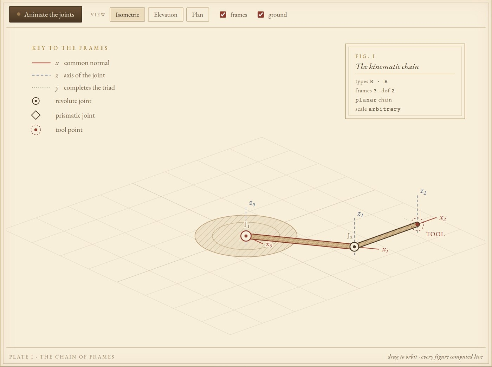
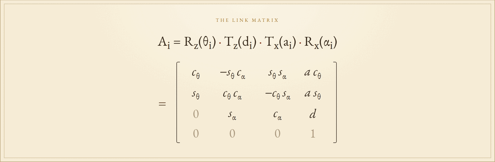

KINEMATICS OF SERIAL CHAINS &nbsp;·&nbsp; MCMLV

<h1>The Denavit–Hartenberg Convention</h1>

<em>Wherein a manipulator is reduced to four numbers per joint, those numbers to four elementary motions, and the motions to a single chain of matrix products, with a working model the reader may turn.</em>

A PRACTICAL TREATISE FOR STUDENTS OF MACHINES

❦

An interactive treatise on the Denavit–Hartenberg method for two- and three-link manipulators. The whole work is a single HTML file: open it, turn the joints, edit the table, and watch the matrices and the drawing follow.

  

<em>Plate I: the chain of frames, drawn live from the table beneath it.</em>

---

## Contents

- **I. The Mechanism.** An orbitable plate with a coordinate frame at every joint, view controls, and a live readout of the tool position.
- **II. The Table of Parameters.** Edit θ, d, a, and α for each joint, mark a joint revolute or prismatic, and load or restore a preset.
- **III. Four Motions, One Matrix.** The four elementary transformations for a selected joint, multiplied in order to compose its link matrix.
- **IV. The Chain of Transformations.** The cumulative products, the tool frame's axes and origin, and the orientation angles.
- **V. A Check by Hand.** For planar chains, the closed-form trigonometry set beside the matrix product.
- **VI. Notes on the Convention.** The standard (distal) convention, reading a homogeneous matrix, and exercises for the student.

## To turn the pages

No installation, no build step, and no server are required. Open `index.html` in any modern browser.

1. Choose **Two Links** or **Three Links** at the top of the page.
2. Drag the plate to orbit the model, or use the **Isometric**, **Elevation**, and **Plan** views.
3. Edit any number in the table. The elementary matrices, the composed link matrices, and the tool pose are recalculated at once.
4. Press **Animate the joints** to sweep the joint variables around their set values.
5. In § V, load a planar preset and compare the hand calculation with the matrix result.

The **R / P** button beside each joint switches it between a revolute joint, whose variable is θ, and a prismatic joint, whose variable is d.

## The convention

This page follows the **standard**, or **distal**, convention: frame {*i*} is fastened to link *i*, its *z* axis lies along the axis of joint *i*, and its *x* axis lies along the common normal from *z**i*−1 to *z**i*. The transform from frame {*i*−1} to frame {*i*} is then

  

with *c*θ = cos θ*i*, *s*θ = sin θ*i*, and likewise for α.

| Symbol | Elementary motion | What it measures |
|:---:|:---|:---|
| θ*i* | rotation about *z**i*−1 | the joint angle, from *x**i*−1 to *x**i* |
| d*i* | translation along *z**i*−1 | the link offset, from the origin of {*i*−1} to the common normal |
| a*i* | translation along *x**i* | the link length, along the common normal |
| α*i* | rotation about *x**i* | the link twist, from *z**i*−1 to *z**i* |

The chain is carried out to the tool by the product

$$
T_n^0 = A_1 A_2 \cdots A_n
$$

whose columns are the tool axes and whose last column is its position.

## Colophon

Set in EB Garamond, IM Fell English, and Courier Prime, with serif and monospace fallbacks for offline reading. The plate is drawn as SVG, the arithmetic is plain JavaScript, and the page keeps no dependencies beyond its web fonts. Prepared for students of machines.

### Reference

> J. Denavit and R. S. Hartenberg, “A kinematic notation for lower-pair mechanisms based on matrices,” *Journal of Applied Mechanics*, 22(2):215 to 221, 1955.

❦

